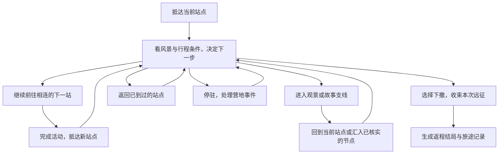

# 鳌太线多分支互动冒险草案

更新日期：2026-11-17。

用户希望在鳌太线大场景中自主选择线路，在多个站点间行进，并可选择下撤。当前产品形态据此向多分支互动冒险推进：真实地点构成站点地图，运动推进所选行程，玩家在自然停顿时决定接下来怎么走。

此前的 18 个候选关卡调整为[站点池与关卡主题](aotai-level-outline.md)，编号用于讨论和资料整理，不表示必须依次通关。实际可连接的地理节点还需核实；本稿先明确游戏规则与体验。

鳌太线是首张地图，后续地图通过[统一内容结构](multi-route-content-and-architecture.md)描述各自站点、连接、分支和事件。行程、暂停、状态保存等共用能力与本路线内容分开设计，支持不同节点数量和玩法组合。

## 站点和行程的关系

| 组成 | 在游戏中的作用 |
| --- | --- |
| 真实站点 | 承载地点景观、到达记录、营地互动与事件。 |
| 节点间的行程 | 玩家选择下一站后，形成一次约 20 分钟的小关卡；关卡以目标站点命名和收尾。 |
| 观景或故事支线 | 在站点或行程中展开，可回到当前站点或汇入后续节点。虚构事件点与真实地点分开标识。 |
| 返回与下撤 | 改变本次远征的走向，可形成返程章节或一个完整结局。 |
| 回访 | 已到过的地点可用于查看记录或重玩。图鉴回访与本次远征中的实际行进分别处理。 |

用户选择的是具有连接关系的下一站。真实地理分岔依据地图资料确定，游戏情景提供停留、观察、交谈等选择。关卡运动量与节点间真实路程的换算仍待设计；用户选择的运动强度不由剧情风险自动提高。

## 一个营地节点上的选择

以下是游戏逻辑示意，节点与下撤出口均为抽象表达，不用于确定现实地理连线。

目标卡可以展示下一站的景观预告、本次约 20 分钟的活动安排，以及可理解的虚拟行程条件。玩家完成一次出发后，再选择接下来的目标。

## 每种选择改变什么

| 选择 | 游戏中的变化候选 | 保留的成果 |
| --- | --- | --- |
| 继续行进 | 到达另一个站点，展开新的景观和事件，按规则变化虚拟时间与补给。 | 已完成运动、已到站点与旅途记录。 |
| 观景支线 | 使用一段虚拟旅途时间，获得不同视角、见闻或收藏，随后回到可继续选择的位置。 | 主路仍可继续，额外运动安排由用户选择。 |
| 停驻休整 | 主动推进一个游戏情景，改变下一章的时段、事件或角色状态。 | 当前站点与已完成运动。 |
| 原路返回 | 回到已访问站点，从另一条已核实连接重新规划。 | 已到达的地点与记录持续保留。 |
| 主动下撤 | 将当前行程收束成一次返程经历，生成独立结局或返程日记。 | 真实运动和已获得的旅途收藏保留，未探索内容留给后续。 |
| 图鉴回访 | 查看本站记录、风景或重新挑战相应内容。 | 不默认改写正在进行的远征状态。 |

以上是规则候选，尚未确定消耗数值、解锁条件或各类结局的具体奖励。

## 现实暂停与虚拟休整的区别

| 情况 | 工作方案 |
| --- | --- |
| 用户接电话、离开画面或需要休息 | 主动暂停会冻结动作判定、剧情、虚拟时间和物资；是否自动暂停及触发方式仍需设计。 |
| 用户现实中已经累了，想结束活动 | 可以立即停止运动并结算已完成内容；下撤可直接叙事收尾，或保存返程内容供下次选择。具体保存方式待讨论。 |
| 玩家在虚拟远征中选择休整 | 作为明确的游戏选择处理，可能推进虚拟时间或改变事件，效果在选择前说明。 |
| 玩家还有运动意愿，想体验一段下撤剧情 | 可将返程设计为可主动进入的小关卡，运动强度仍由用户选择。 |

游戏下撤不能要求已经疲惫的用户额外完成一关运动才能结束。运动强度和旅途情景的紧张程度分别设计。

## 分支怎样形成可重玩的内容

路线可以在后续节点重新汇合。不同选择留下事件标记、不同的物件与日记，使同一站点在下一次抵达时呈现不同内容。

例如，同一个营地事件可以由三种条件改变：玩家从哪个节点来到这里、带来了什么游戏物件、此前选择过停驻还是继续。景观仍对应同一真实地点，角色见闻、时段表现和可选事件发生变化。

重玩的目标可以是补全旅途册、体验另一条已核实分支、改变一次先前的选择，或与朋友交流各自的路线。玩家无需在一次远征里抵达全部站点。

## 一个包含彩蛋的分支情景

示例名称：营地里的烤肠传闻。以下事件与文案为原创候选，不表示现实地点存在摊位。完整的选择预告、具体食物消耗、随行装备、后续行程与结局见[水窝子营地分支样例](aotai-shuiwozi-branch-example.md)，其中数量、用途与保存方式仍是候选。装备分类、配套使用与出发前准备见[背包与装备草案](backpack-and-equipment.md)。

玩家在营地读到一张传闻卡：有人说山脚有个烤肠摊。此时提供三种选择：

1. 继续向下一站出发，把传闻夹进旅途册，留作后续回访线索。
2. 在营地停驻，触发一次观察和旅人交谈，得到另一种见闻。
3. 收束本次远征进入返程结局，在虚拟山脚吃到一根烤肠。

三种选择交付不同的叙事与收藏，保留已经完成的真实运动。分支 3 的原创成就名候选为“稳得可怕”；它借用了网上自信表达的反差，并非已核实的原梗名称。

玩家现实中想停止运动时可以直接进入收尾；愿意继续玩返程的用户，再主动选择相应活动。景观与虚拟彩蛋摊位分别呈现，避免把虚构经营设施混进实景资料。

## 彩蛋在整体风格中的位置

网络梗优先转成事件卡、虚拟物件、旅途册和结局里的小惊喜，具体素材线索见[网络梗与彩蛋素材笔记](aotai-memes.md)。用户运动时，动作提示仍优先；需要理解和选择的笑点放在停顿时呈现。

真实人物的经历可作为理解题材与人情的参考，人物致敬与虚构搞笑角色分别设计。首批笑点围绕玩家的自信、自嘲、荒诞物件和返程反差展开。中文梗也需要写成独立可理解的小事件，便于海外内容适配。

## 下一步需要具体推敲的规则

- 站点地图中哪些连接有地理依据，哪些只是本站内的剧情事件。
- 每次选择怎样改变下一站、虚拟时间、背包里具体的食物与物品或后续事件，怎样在选择前让用户看懂。
- 装备怎样支持营地、天气、行进和观景事件，哪些采用默认套装，哪些让玩家自选。
- 按[首版简化草案](backpack-and-equipment.md)推敲一条角色体力槽与少量剧情事件，怎样影响休整、后续选择与返程叙事。
- 一次返程结局怎样兼顾已完成成果和下次出发的期待。
- 根据水窝子样例继续检验：饼干路餐、营地煮面与分享巧克力是否形成有趣的选择，约 20 分钟的收尾是否清楚，以及行进中的动作与声音怎样承接冒险。
