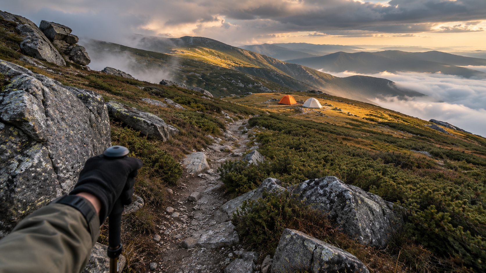

# 第一人称山地冒险：概念关键帧 v1

生成日期：2026-11-17。

用途：对齐 Roamove 的第一人称、写实、具有视觉冲击力的风景方向。此图为虚构的秦岭高山氛围概念，尚未依据水窝子营地原始资料还原；用于构图与质感讨论，具体地貌需另行核实。



## 生成与文件信息

- 工具：内置 `image_gen`，通过 `imagegen` 技能的默认模式生成。
- 结果：静态 PNG，1672 × 941。
- 文件：[shuiwozi-first-person-concept-v1.png](shuiwozi-first-person-concept-v1.png)。
- 未使用 Seedance 生成，未测试视频运动、循环或跨镜头一致性。
- 当前定位：待用户评估的视觉样稿，尚未选为最终视觉基准或生产素材。

## 从本图继续推敲什么

本图以站立人眼高度看向前方，近处手套、登山杖与石块提供身体在场的线索，路径引向远处营地；云层、自然光和远山层次提供景观冲击。

后续先核实真实地点与机位，再测试缓慢前进时的空间稳定、手部与装备的一致性、画面在手机上的细节，以及停顿后展开大景的节奏。动态视频质量仍需独立验收。

## 最终生成提示词

以下是本次使用的完整提示词；未输入参考图片。

```text
Use case: photorealistic-natural.
Asset type: one cinematic first-person visual concept keyframe for the Roamove nature adventure app. This is an original imagined scene inspired by the Qinling high mountains in China, NOT a documentary reconstruction of the real Shuiwozi campsite.
Primary request: an exceptionally convincing, photorealistic first-person hiking view, immersive and visually striking through natural mountain scale, atmosphere, fine material detail and lighting.
Scene: a believable high mountain path of weathered gray granite, low green-brown alpine vegetation, open rounded mountain ridges and rocky slopes. The path leads gently toward a small campsite in a clearing, with two simple trekking tents at human scale. Layered distant ridges, drifting thin mist and a broad cloud layer in the valley. The terrain should feel grounded and natural rather than fantastical. No lake, no giant needle-shaped snowy peaks.
Viewpoint and composition: the hiker's own standing eye-level view, approximately normal adult height, facing forward along the path, with a natural 28mm rectilinear photographic lens. A small, anatomically correct gloved hand and forearm holding one trekking pole is partially visible along the lower edge, giving a subtle sense of being physically present. The landscape occupies most of the image. Foreground rocks have rich natural texture, the middle ground draws the eye toward the campsite, and the distant mountains open into an expansive view. A single coherent wide landscape frame, ideally 16:9. No third-person avatar and no aerial or drone viewpoint.
Lighting and mood: late-afternoon light after passing mountain clouds; a shaft of warm sunlight lights part of the distant ridge and the campsite, contrasting with cool gray-green shaded foreground. Realistic atmospheric depth, restrained lens glow, photographic dynamic range, natural color, subtle filmic finish. Visually awe-inspiring, tactile, quiet and adventurous. High detail without oversharpening, plastic surfaces or excessive saturation.
Constraints: one still image, believable coherent geometry and physical scale; naturally posed partial hand; no writing, no HUD, no menus, no logos, no watermark, no collage, no border, no magical effects. Aim for premium outdoor cinematography rather than a stylized game screenshot.
```
