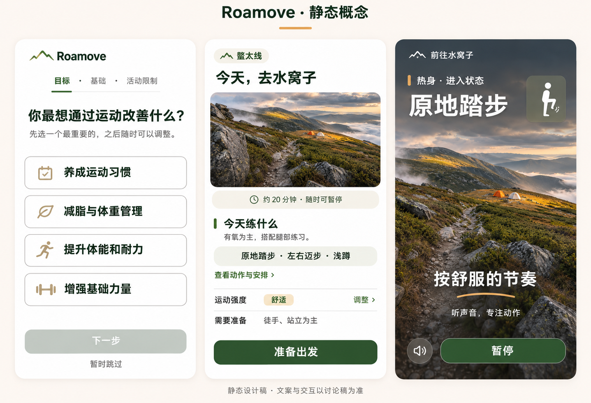

# 三屏静态视觉示意

日期：2026-11-17。状态：供产品讨论的概念图，不是运行中的 App。

## 这张图用来判断什么

- 首次评估保持一题一屏，沿用已确认的四个目标和跳过入口，没有预选答案。
- 训练预览同时交代目的地、约需时间、动作、强度和准备条件；“准备出发”之后仍需准备与试做。
- 运动中放大当前动作、节奏和暂停入口，景观保持第一人称。声音承担主要引导，屏幕供需要时查看。

三屏中的预览布局和运动界面仍是推荐方案。生成图采用竖向屏幕方便比较信息层级，不代表已确定正式运动模式的横竖屏策略、相机视角或最终设备适配。

## 生成与来源

使用内置 `image_gen` 工具生成，作为产品探索资产复制进仓库。输出文件为 [three-screen-concept-v1.png](assets/three-screen-concept-v1.png)，实际尺寸 1518 × 1036 像素；[完整原始提示词](assets/three-screen-concept-v1.prompt.txt)随图保存。

生成时仅将已有的[第一人称山地概念图](../concepts/shuiwozi-first-person-concept-v1.png)作为第二、三屏的景观参考。它是生成的虚构自然场景，没有证明水窝子的真实山形、路径或营地布局。画面也不表示已经取得实景素材或完成 Seedance 视频试片。

## 读图时的边界

主标题、四个选项、准备与暂停入口已做目视检查；复杂地名在小字号下仍可能出现生成字形偏差，正式界面需要真实字体排版与逐字核对。不能从这张合成图验收触控尺寸、对比度、读屏、远距离可读性或动作示范准确性。

图中的动作小图标只是占位，后续应采用与课程一致、经过审阅的示范。运动时是否需要常驻图标、自拍反馈或其他辅助，也应由摆位和声音理解验证决定。
